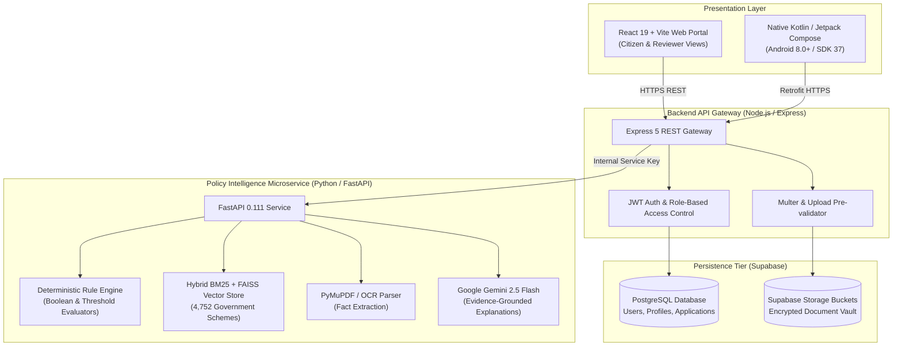

<p align="center">
  
</p>

<h1 align="center">FIN — Financial Policy Intelligence</h1>

<p align="center">
  <strong>Grounded Civic Intelligence for Indian Government Schemes, Subsidies & Benefits</strong>
</p>

<p align="center">
  An evidence-grounded civic intelligence platform that transforms 4,752+ unstructured Indian public policy guidelines into tailored scheme recommendations, deterministic eligibility verifications, quantified benefit calculations, and streamlined application workflows.
</p>

<p align="center">
  <a href="https://fin-tech-portal.vercel.app/"></a>
  <a href="https://fin-backend-99yh.onrender.com/"></a>
  <a href="https://fin-intelligence.onrender.com/"></a>
  <a href="android_app/app/build/outputs/apk/debug/app-debug.apk"></a>
</p>

<p align="center">
  
  
  
  
  
  
  
  
</p>

---

## 📑 Table of Contents

- [🎯 Problem Statement (PS) Notes](#-problem-statement-ps-notes)
- [💡 Solution Overview](#-solution-overview)
- [🎯 Project Goals](#-project-goals)
- [✨ Key Features](#-key-features)
- [⚖️ Comparison: MyScheme.gov.in vs. FIN](#️-comparison-myschemegovin-vs-fin)
- [🌐 Live Demo & Links](#-live-demo--links)
- [📸 Screenshots](#-screenshots)
- [🛠️ Tech Stack](#️-tech-stack)
- [🚀 Installation & Setup](#-installation--setup)
- [📱 Running the Mobile App](#-running-the-mobile-app)
- [📁 Project Structure](#-project-structure)
- [🗺️ Roadmap / Future Scope](#️-roadmap--future-scope)
- [👥 Team & Acknowledgements](#-team--acknowledgements)
- [📄 License & Contact](#-license--contact)

---

## 🎯 Problem Statement (PS) Notes

<!-- TODO: Update with your official HackMatrix Problem Statement Number / Title -->
> **Problem Statement ID / Title:** `<!-- TODO: e.g., PS-04: AI-driven Civic Welfare Access & Governance -->`  
> **Event:** HackMatrix 2026, Pimpri Chinchwad College of Engineering (PCCOE)

### The Official Statement & Context
> *"Every year, the Government of India and State administrations announce hundreds of welfare schemes, scholarships, credit subsidies, and grants. However, over 60% of eligible citizens fail to access these benefits due to bureaucratic opacity, complex Gazette guidelines, fragmented ministerial portals, and cumbersome documentation requirements."*

### Key Challenges
1. **Information Fragmentation:** Welfare policies are distributed across 50+ independent ministries and regional departments, each maintaining separate portals with contradictory eligibility rules.
2. **Ambiguous Criteria & Verification Uncertainty:** Citizens cannot readily determine whether their household income, caste certificates, landholding records, or age thresholds strictly qualify them before investing time and money.
3. **High Document Rejection Rates:** Applicants face rejection after weeks of waiting due to minor document mismatches, expired certificates, or missing sub-clauses.
4. **Digital & Language Divide:** Complex policy documents are written in formal legal vernacular with no accessible translation, voice synthesis, or intuitive mobile experiences for rural citizens.

### Who is Affected
- **Marginalized & Low-Income Citizens:** Smallholder farmers, daily wage workers, rural women, and elderly citizens needing pensions.
- **Students & Aspiring Scholars:** First-generation college students seeking merit-cum-means scholarships.
- **Micro & Small Entrepreneurs (MSMEs):** Artisans and startup founders seeking seed capital and credit guarantees.
- **Civic Administrators & Reviewers:** Block development officers and reviewers overwhelmed with unverified, incomplete dossiers.

---

## 💡 Solution Overview

**FIN (Financial Policy Intelligence)** bridges the civic gap by transforming passive, unstructured government policy documents into an **interactive, evidence-grounded civic intelligence platform**.

Rather than relying on generic, hallucinatory chatbot prompts, FIN deploys a **hybrid intelligence pipeline**:
- **Deterministic Evaluation Engine:** Evaluates strict boolean conditions, income ceilings, land caps, and demographic criteria using auditable code rules.
- **Hybrid RAG Policy Retrieval:** Pairs BM25 keyword matching with FAISS vector embeddings across a comprehensive corpus of **4,752 indexed Central & State schemes**.
- **Side-by-Side OCR Document Fact Extraction:** Extracts certificate dates, authority stamps, certificate IDs, and applicant names from scanned PDFs and photos, pre-validating requirements before submission.
- **Grounded Plain-Language Explanations:** Explains exact pass/fail reasons citing the **specific government policy clause, gazette reference, and official rule number**.

### High-Level System Architecture



---

## 🎯 Project Goals

- **Zero Information Asymmetry:** Empower citizens with instant semantic discovery across all 4,752+ Central and State welfare initiatives.
- **Zero-Hallucination Decisions:** Guarantee all eligibility outcomes (`ELIGIBLE`, `INELIGIBLE`, `BORDERLINE`, `UNKNOWN`) are backed by deterministic arithmetic rules and legal clause citations.
- **Pre-Submission Confidence:** Prevent application rejections by pre-evaluating uploaded income certificates, domicile proofs, and identity documents using OCR metadata inspection.
- **Universal Civic Accessibility:** Provide seamless web and native mobile experiences with multi-lingual support across 13 Indian languages and voice assistance.
- **Auditable Governance:** Provide government reviewers with dedicated administrative audit queues, document verification split-views, and tamper-evident application receipts.

---

## ✨ Key Features

| Emoji | Feature | Citizen / Reviewer Benefit |
| :---: | :--- | :--- |
| 🔍 | **Semantic Scheme Discovery** | Search 4,752+ schemes instantly using natural language, category tags, or keyboard shortcut (`Ctrl+K`). |
| ⚖️ | **Deterministic Eligibility Checker** | Receive an instant, transparent 4-state verdict with quantified financial benefit amounts (e.g. ₹50,000/yr). |
| 📑 | **Evidence Clause Provenance** | Review exact legal citations, gazette clause numbers, and official criteria for every decision. |
| 📂 | **Document Vault & AI OCR** | Upload Aadhaar, PAN, and Income Certificates with automatic metadata extraction (certificate number, issue date, authority). |
| 🤖 | **Grounded FIN AI Assistant** | Ask civic policy questions in natural language and receive grounded answers backed strictly by scheme data. |
| 📱 | **Full Native Android App** | Access all citizen & reviewer features on mobile with offline token caching, smooth Jetpack Compose UI, and biometric keystore security. |
| 🏛️ | **Dual-Role Reviewer Dashboard** | Government officials can audit applications, inspect side-by-side OCR documents, and log official decisions (`Approve`, `Changes Needed`, `Reject`). |
| 🌐 | **13 Indian Languages & TTS** | Complete DOM-level translation across English, Hindi, Marathi, Gujarati, Tamil, Telugu, Bengali, Kannada, Malayalam, Punjabi, Urdu, Odia, and Assamese. |
| 🧾 | **Official Acknowledgement Receipt** | Generate shareable, verified submission receipts with unique reference IDs for tracking and grievance redressal. |

---

## ⚖️ Comparison: MyScheme.gov.in vs. FIN

| Capability | MyScheme.gov.in (Official Portal) | FIN — Financial Policy Intelligence | Status |
| :--- | :---: | :---: | :---: |
| **Scheme Corpus & Discovery** | ✅ Comprehensive directory | ✅ 4,752 Central & State Schemes indexed | Parity |
| **Personalized Recommendations** | ⚠️ Generic questionnaire | ✅ Profile-driven dynamic compatibility matching | **Differentiator** |
| **Eligibility Verification** | ⚠️ Self-reported questionnaire | ✅ Deterministic rule evaluation with arithmetic thresholds | **Differentiator** |
| **Document Guidance & Fact Extraction** | ❌ Static list of required files | ✅ Active OCR extraction (Aadhaar, Income certs, PAN) | **Differentiator** |
| **Legal Clause Citations** | ❌ Generic eligibility bullets | ✅ Exact policy clause numbers & gazette citations | **Differentiator** |
| **Conversational AI Assistant** | ❌ Basic rule-based FAQ bot | ✅ Grounded RAG assistant powered by Gemini 2.5 Flash | **Differentiator** |
| **Native Mobile App (Offline Keystore)** | ❌ Responsive web portal only | ✅ Native Kotlin + Jetpack Compose Android app | **Differentiator** |
| **Administrative Reviewer Workflow** | ❌ Citizen-only portal | ✅ Built-in Reviewer audit queue with document split-views | **Differentiator** |
| **Language Inclusivity & Voice** | ⚠️ Major Indian languages | ✅ 13 Indian languages + browser speech synthesis (TTS) | **Differentiator** |
| **Application Tracking & Receipt** | ⚠️ Redirects to external ministry sites | ✅ Unified tracking timeline + shareable acknowledgement receipt | **Differentiator** |

> **Why FIN Matters:**  
> While *MyScheme.gov.in* is an admirable informational catalog, it places the heavy burden of reading multi-page legal PDFs and verifying sub-clauses entirely on the citizen. **FIN transforms passive reading into an active, verified decision engine**: it verifies documents via OCR, tests eligibility through mathematical code checks, cites legal clauses, and connects directly to reviewer audit queues.

---

## 🌐 Live Demo & Links

- **Live Citizen & Reviewer Web Portal:** [https://fin-tech-portal.vercel.app](https://fin-tech-portal.vercel.app/)
- **Backend API Gateway (REST):** [https://fin-backend-99yh.onrender.com](https://fin-backend-99yh.onrender.com/)
- **Intelligence Microservice:** [https://fin-intelligence.onrender.com](https://fin-intelligence.onrender.com/)
- **Interactive OpenAPI Documentation:** [https://fin-intelligence.onrender.com/docs](https://fin-intelligence.onrender.com/docs)
- **Direct Native Android APK Download:**
  
  <p align="left">
    <a href="android_app/app/build/outputs/apk/debug/app-debug.apk">
      
    </a>
  </p>

- **Demonstration Video:** `<!-- TODO: Add YouTube / Loom video link, e.g., https://youtu.be/xxxxxx -->`
- **Presentation Pitch Deck:** `<!-- TODO: Add Canva / Google Slides pitch deck link -->`

---

## 📸 Screenshots

| Citizen Dashboard & Schemes | Deterministic Eligibility Verdict |
| :---: | :---: |
| <br><em><!-- TODO: Replace with citizen dashboard screenshot --></em> | <br><em><!-- TODO: Replace with eligibility verdict screenshot --></em> |

| Document Vault & OCR Fact Extraction | Native Android App (Compose) |
| :---: | :---: |
| <br><em><!-- TODO: Replace with document vault screenshot --></em> | <br><em><!-- TODO: Replace with Android app screenshot --></em> |

| Government Reviewer Audit Queue | Grounded Multilingual AI Assistant |
| :---: | :---: |
| <br><em><!-- TODO: Replace with reviewer queue screenshot --></em> | <br><em><!-- TODO: Replace with AI assistant screenshot --></em> |

---

## 🛠️ Tech Stack

| Layer | Technologies | Rationale / Purpose |
| :--- | :--- | :--- |
| **Mobile (Android)** | Kotlin 2.1, Jetpack Compose, Material 3, Retrofit, OkHttp 4, Android KeyStore AES-256 | High-performance, modern native Android experience with hardware-backed encrypted session tokens and responsive phone layout. |
| **Frontend (Web)** | React 19.2, Vite 8.3, React Router 7, Vanilla CSS Tokens, Lucide React, Web Speech API | Ultra-fast, zero-dependency SPA with custom Playfair Display typography, responsive UI, and client-side translation. |
| **Backend Gateway** | Node.js 18+, Express 5.2, Multer, JWT, Supabase JS, CORS Whitelisting | Robust API gateway coordinating authentication, role-based access control, file upload validation, and microservice proxying. |
| **AI Intelligence** | Python 3.11, FastAPI 0.111, Pydantic v2, PyMuPDF, FAISS CPU, Pandas, NumPy | High-throughput asynchronous RAG service managing vector search across 4,752 schemes and PDF document attribute extraction. |
| **LLM & Inference** | Google Gemini 2.5 Flash, Hybrid BM25 Lexical + FAISS Vector Store | Grounded natural language explanations strictly constrained by retrieved policy clauses to eliminate hallucinations. |
| **Database & Storage** | Supabase PostgreSQL, Supabase Storage Buckets | Managed cloud PostgreSQL with relational schemas, Row-Level Security (RLS), and encrypted object storage for documents. |
| **Cloud Hosting** | Vercel (Web CDN), Render (Backend Gateway & Intelligence Service) | Distributed, zero-maintenance global deployment pipeline with automated GitHub CI/CD triggers. |

---

## 🚀 Installation & Setup

### Prerequisites
- **Node.js:** v18.x or v20.x ([Download Node.js](https://nodejs.org/))
- **Python:** v3.10.x or v3.11.x ([Download Python](https://www.python.org/))
- **Java Development Kit (JDK):** JDK 17 or JDK 21 (for Android build)
- **Git:** Latest version

### 1. Clone the Repository
```bash
git clone https://github.com/DhruvOzha85/GyaanSetu.git
cd GyaanSetu
```

### 2. Environment Variables Configuration

Create a `.env` file in each relevant folder based on the templates below:

<details>
<summary><strong>📄 View BackEnd/.env Configuration</strong></summary>

```env
PORT=5000
NODE_ENV=development
SUPABASE_URL=https://your-supabase-project.supabase.co
SUPABASE_SERVICE_ROLE_KEY=your-supabase-service-role-key
JWT_SECRET=your-secure-jwt-secret-key-32-chars-min
JWT_EXPIRES_IN=7d
INTELLIGENCE_SERVICE_URL=http://localhost:8000
AI_SERVICE_SECRET_KEY=your-shared-ai-service-secret
FRONTEND_URL=http://localhost:5173
```
</details>

<details>
<summary><strong>📄 View Intelligence/.env Configuration</strong></summary>

```env
PORT=8000
ENVIRONMENT=development
GEMINI_API_KEY=your-google-gemini-api-key
GEMINI_MODEL=gemini-2.5-flash
AI_SERVICE_SECRET_KEY=your-shared-ai-service-secret
SUPABASE_URL=https://your-supabase-project.supabase.co
SUPABASE_SERVICE_ROLE_KEY=your-supabase-service-role-key
```
</details>

<details>
<summary><strong>📄 View FrontEnd/.env Configuration</strong></summary>

```env
VITE_API_BASE_URL=http://localhost:5000/api
```
</details>

---

### 3. Run the Services Locally

#### Step A: Run Backend API Gateway
```bash
cd BackEnd
npm install
npm run dev
# Server runs at http://localhost:5000
```

#### Step B: Run Intelligence Microservice
```bash
cd Intelligence
python -m venv venv
# On Windows:
.\venv\Scripts\activate
# On Linux/macOS:
source venv/bin/activate

pip install -r requirements.txt
uvicorn main:app --reload --port 8000
# API docs at http://localhost:8000/docs
```

#### Step C: Run Frontend Web Portal
```bash
cd FrontEnd
npm install
npm run dev
# Web portal opens at http://localhost:5173
```

---

## 📱 Running the Mobile App

The native Android app is located in `android_app/` and supports Android 8.0 (API level 26) through Android 16 (API level 37).

### Option A: Install Pre-built APK on a Physical Android Phone

1. Transfer the pre-built APK file to your phone:
   - **Path:** [`android_app/app/build/outputs/apk/debug/app-debug.apk`](android_app/app/build/outputs/apk/debug/app-debug.apk) (approx. 24 MB).
   - Transfer via USB file transfer, Google Drive, WhatsApp, or Telegram.
2. On your Android phone, open your **Files** app and tap `app-debug.apk`.
3. If prompted: *"For your security, your phone is not allowed to install unknown apps from this source"*, tap **Settings** and toggle **"Allow from this source"**.
4. Tap **Install** and launch **FIN**.

> [!TIP]
> **Connecting Mobile App to Local Backend:**  
> When testing on a physical phone connected to your PC via USB cable, run:
> ```powershell
> adb reverse tcp:5000 tcp:5000
> ```
> This automatically forwards `http://127.0.0.1:5000/` requests on the phone directly to your computer's backend!

---

### Option B: Build & Run from Source (Android Studio / CLI)

#### Using Android Studio:
1. Open Android Studio, select **Open**, and browse to the `android_app/` folder.
2. Allow Gradle sync to complete.
3. Select your connected physical device or an Android Virtual Device (AVD).
4. Click the green **Run (▶)** button.

#### Using Terminal (PowerShell / Bash):
```bash
cd android_app

# Run all 124 automated unit tests
.\gradlew.bat testDebugUnitTest

# Build the Debug APK
.\gradlew.bat assembleDebug

# Install directly to your connected device
.\gradlew.bat installDebug
```

---

## 📁 Project Structure

```text
PCCOE-HackMatrix/
├── FrontEnd/                     # React 19 + Vite web application
│   ├── src/
│   │   ├── components/           # Reusable UI components (Navbar, Modals, Radar)
│   │   ├── context/              # Auth, Language, and Global State
│   │   ├── pages/                # Citizen Portal & Reviewer Dashboard views
│   │   └── services/             # Axios API client bindings
│   └── package.json
│
├── BackEnd/                      # Node.js + Express REST API Gateway
│   ├── src/
│   │   ├── config/               # Supabase and environment loaders
│   │   ├── middleware/           # JWT Auth, Role RBAC, File Upload guards
│   │   ├── routes/               # /auth, /schemes, /documents, /applications
│   │   └── services/             # Intelligence proxy & database queries
│   └── package.json
│
├── Intelligence/                 # Python + FastAPI civic policy microservice
│   ├── data/                     # 4,752 indexed Central & State policy guidelines
│   ├── src/
│   │   ├── evaluation/           # Deterministic rule engine & arithmetic checks
│   │   ├── retrieval/            # BM25 + FAISS vector search across schemes
│   │   └── extraction/           # PyMuPDF / OCR certificate fact parser
│   ├── main.py                   # FastAPI entrypoint
│   └── requirements.txt
│
├── android_app/                  # Native Kotlin + Jetpack Compose Android application
│   ├── app/src/main/
│   │   ├── java/com/fin/mobile/
│   │   │   ├── data/             # Retrofit DTOs, Repositories, Encrypted Storage
│   │   │   ├── ui/               # Jetpack Compose screens (Auth, Schemes, Vault, Chat)
│   │   │   └── MainActivity.kt   # Single-activity navigation root
│   │   ├── res/                  # Vector drawables, fonts, XML security configs
│   │   └── AndroidManifest.xml
│   ├── build.gradle.kts          # App build configurations
│   └── gradlew.bat
│
└── docs/                         # Architecture documentation, design specs & assets
    ├── assets/                   # FIN logo, branding marks, and screenshots
    └── DEPLOYMENT_READINESS.md   # Deployment runbooks and security audits
```

---

## 🗺️ Roadmap / Future Scope

- [ ] **Aadhaar e-KYC Integration:** Direct integration with UIDAI sandboxes for automated one-tap biometric profile completion.
- [ ] **WhatsApp & Telegram Chatbot:** Conversational eligibility discovery accessible via messaging apps for citizens without smartphones.
- [ ] **DigiLocker Direct Pull:** Fetch verified caste, income, and domicile certificates directly from government repositories with zero scanning required.
- [ ] **Automated DBT Bank Reconciliations:** Real-time integration with Public Financial Management System (PFMS) for end-to-end subsidy disbursement tracking.
- [ ] **Multimodal Voice-First Assistant:** Vernacular voice input and responses for low-literacy rural applicants.

---

## 👥 Team & Acknowledgements

### Team Members
<!-- TODO: Add your team name and member details below -->
- **Dhruv Ojha** — Full Stack & Android Architecture — [GitHub (@DhruvOzha85)](https://github.com/DhruvOzha85)
- `<!-- TODO: Member 2 Name -->` — `<!-- Role -->` — `<!-- GitHub Link -->`
- `<!-- TODO: Member 3 Name -->` — `<!-- Role -->` — `<!-- GitHub Link -->`
- `<!-- TODO: Member 4 Name -->` — `<!-- Role -->` — `<!-- GitHub Link -->`

### Acknowledgements
- **HackMatrix 2026** Organizers and Mentors at **Pimpri Chinchwad College of Engineering (PCCOE)**.
- **MyScheme.gov.in** and the **National Informatics Centre (NIC)** for publishing open public welfare policy datasets.
- Open-source communities behind **React**, **FastAPI**, **Jetpack Compose**, and **Google Gemini**.

---

## 📄 License & Contact

Distributed under the **MIT License**. See `LICENSE` for more information.

For inquiries, partnerships, or hackathon jury questions:
- **Project Lead:** Dhruv Ojha (`ozhadhruv@gmail.com`)
- **Repository:** [https://github.com/DhruvOzha85/GyaanSetu](https://github.com/DhruvOzha85/GyaanSetu)
- **Live Portal:** [https://fin-tech-portal.vercel.app](https://fin-tech-portal.vercel.app)
