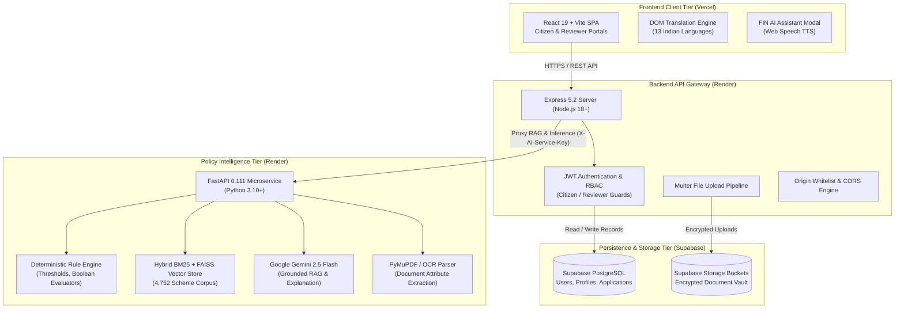
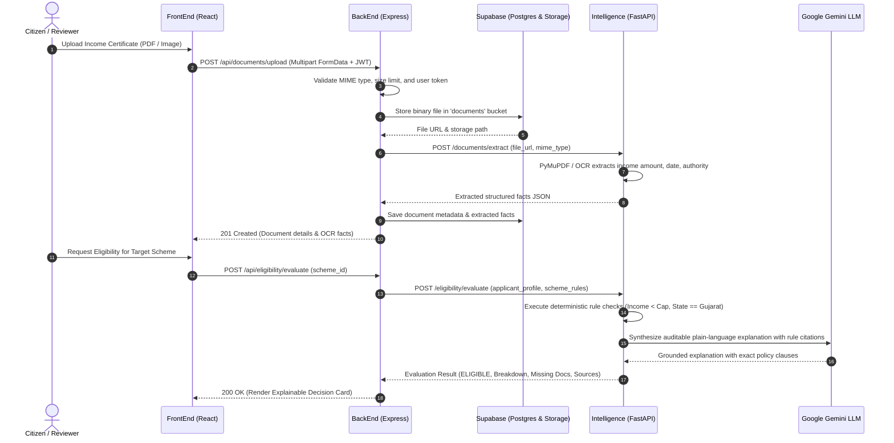

<p align="center">
  
</p>

<h1 align="center">FIN — Financial Policy Intelligence</h1>

<p align="center">
  <strong>Making government schemes easier to discover, understand, and access.</strong>
</p>

<p align="center">
  An evidence-grounded, explainable civic intelligence platform that transforms complex Indian public policies into tailored scheme recommendations, deterministic eligibility verifications, quantified benefit calculations, and streamlined application workflows.
</p>

<p align="center">
  <a href="https://fin-tech-portal.vercel.app/"></a>
  <a href="https://fin-backend-99yh.onrender.com/"></a>
  <a href="https://fin-intelligence.onrender.com/"></a>
</p>

<p align="center">
  
  
  
  
  
  
  
  
</p>

---

## 📑 Table of Contents

- [🌐 Live Deployments](#-live-deployments)
- [🎯 The Problem \& Our Solution](#-the-problem--our-solution)
- [✨ Core Capabilities](#-core-capabilities)
- [🏛️ System Architecture](#️-system-architecture)
- [🔄 Request Lifecycle \& Intelligence Flow](#-request-lifecycle--intelligence-flow)
- [🛠️ Tech Stack](#️-tech-stack)
- [📁 Repository Structure](#-repository-structure)
- [⚙️ Prerequisites](#️-prerequisites)
- [🚀 Local Installation \& Setup Guide](#-local-installation--setup-guide)
  - [1. Clone Repository](#1-clone-repository)
  - [2. BackEnd Gateway Setup](#2-backend-gateway-setup)
  - [3. FrontEnd Portal Setup](#3-frontend-portal-setup)
  - [4. Intelligence Microservice Setup](#4-intelligence-microservice-setup)
  - [5. Local Service URL Registry](#5-local-service-url-registry)
- [🔐 Environment Variables Reference](#-environment-variables-reference)
- [📡 API Documentation](#-api-documentation)
- [👤 End-to-End User Journeys](#-end-to-end-user-journeys)
- [🧪 Automated Testing \& Verification](#-automated-testing--verification)
- [🔧 Troubleshooting \& Operational Guide](#-troubleshooting--operational-guide)
- [👥 Contributing \& Development Workflow](#-contributing--development-workflow)
- [📄 License \& Attribution](#-license--attribution)

---

## 🌐 Live Deployments

The FIN platform is deployed as a tri-service distributed civic application across high-availability cloud infrastructure:

| Tier | Service | Deployment Host | Production URL | Status |
| :--- | :--- | :--- | :--- | :--- |
| **Frontend** | Citizen Portal & Reviewer Dashboard | Vercel | [https://fin-tech-portal.vercel.app](https://fin-tech-portal.vercel.app/) | `Operational` |
| **Backend** | Express REST Gateway & Auth Service | Render | [https://fin-backend-99yh.onrender.com](https://fin-backend-99yh.onrender.com/) | `Operational` |
| **Intelligence** | FastAPI RAG & Policy Rule Microservice | Render | [https://fin-intelligence.onrender.com](https://fin-intelligence.onrender.com/) | `Operational` |
| **Interactive Docs** | OpenAPI / Swagger Interface | Render | [https://fin-intelligence.onrender.com/docs](https://fin-intelligence.onrender.com/docs) | `Operational` |

> [!NOTE]
> All three services are verified by the project maintainers in a working state. When accessing the Backend or Intelligence microservice on Render after a period of dormancy, the initial request may take 20–40 seconds due to serverless free-tier container spinning. Subsequent requests execute with sub-second response times.

---

## 🎯 The Problem & Our Solution

### The Challenge: Bureaucratic Information Overload

Every year, the Government of India and respective State administrations allocate hundreds of thousands of crores to welfare, credit subsidy, scholarship, agricultural, and enterprise development programs. However:

1. **Information Fragmentation:** Eligibility rules are buried across hundreds of separate ministry websites, unstandardized Gazette notifications, multi-page PDF guidelines, and vernacular forms.
2. **Ambiguous Criteria:** Citizens struggle to answer fundamental questions: *"Am I eligible under the latest household income caps?"*, *"Which certificate qualifies as proof of landholding?"*, or *"How much benefit will I actually receive?"*
3. **High Application Rejection Rates:** Applicants spend weeks gathering documents only to be rejected due to a single missing statutory certificate or miscalculated borderline threshold.

### The FIN Solution: Grounded Civic Intelligence

FIN solves this by transforming unstructured public policy documents into an **auditable, deterministic, and explainable intelligence engine**.

Instead of treating public assistance as a black-box guessing game or an unchecked generative AI prompt, FIN combines:
- **Deterministic Rule Verification:** Strict boolean, mathematical, and demographic constraints computed directly against applicant data.
- **RAG Policy Ingestion:** Hybrid BM25 lexical and FAISS vector retrieval across **4,752 indexed government schemes**.
- **Evidence-Grounded Explanations:** Every eligibility determination references the **exact policy clause, rule number, and official government document source**.

```text
                  UNSTRUCTURED INPUTS                                         STRUCTURED OUTPUTS
┌────────────────────────────────────────────────────────┐     ┌─────────────────────────────────────────────────┐
│ • Applicant Profile (Income, State, Category, Land)    │     │ ✅ Statutory Eligibility Status (Pass/Fail/Review)│
│ • Uploaded Document Proofs (Aadhaar, PAN, Income Cert) │ ──► │ 📑 Official Clause Provenance & Citations       │
│ • 4,752 Central & State Government Policy Guidelines   │     │ 💰 Quantified Benefit Calculation (e.g. ₹50,000)│
│                                                        │     │ ⚠️ Missing Required Document Checklist         │
└────────────────────────────────────────────────────────┘     └─────────────────────────────────────────────────┘
```

> [!IMPORTANT]
> **Safety & Integrity Invariant:** FIN does not claim that AI models independently grant government approvals or legally authenticate original documents. Legal verification is retained by authorized government reviewers using FIN's specialized Reviewer Dossier Audit tools.

---

## ✨ Core Capabilities

### 1. 🔍 Scheme Discovery & Semantic Search
- **4,752 Comprehensive Schemes:** Indexes central schemes (Ministry of Agriculture, MSME, MoHUA, Social Justice, Education) and state welfare policies.
- **Global `⌘ K` / `Ctrl K` Quick Lookup:** Instant keyboard-driven scheme search across titles, beneficiaries, tags, and ministries.
- **Multi-Faceted Filtering:** Categorization by sector (Agriculture, Education, Health, Housing, Business, Social Welfare, Employment).
- **Match Scoring:** Dynamic compatibility score evaluating how closely an applicant's profile aligns with scheme requirements.

### 2. ⚖️ Deterministic Eligibility Intelligence
- **Statutory 4-State Classification:**
  - `ELIGIBLE`: All mandatory conditions verified by applicant data and document evidence.
  - `INELIGIBLE`: Explicit violation of one or more mandatory threshold rules (with exact failure reason shown).
  - `BORDERLINE / REVIEW`: Information borderline close to threshold or conflicting evidence detected.
  - `UNKNOWN / MISSING INFO`: Insufficient applicant facts to confirm or deny qualification.
- **No Hallucinated Decisions:** Eligibility calculations run through dedicated mathematical evaluators rather than free-form LLM hallucinations.

### 3. 📂 Document Vault & AI OCR Fact Extraction
- **Multi-Format Upload:** Secure handling of PDF, JPEG, and PNG certificates stored in encrypted Supabase storage buckets.
- **Side-by-Side OCR Fact Inspector:** View raw uploaded scans directly alongside AI-extracted metadata (certificate number, issued date, verified income, authority seal).
- **Document Readiness Radar:** Real-time checklist determining which uploaded proofs satisfy requirements for target schemes.

### 4. 🤖 Grounded Conversational FIN AI Assistant
- **Retrieval-Augmented Chat:** Real-time questions answered with direct citations from scheme documentation.
- **Multilingual Indian Language Support:** Seamless DOM-level translation across **13 Indian languages** (English, Hindi, Marathi, Gujarati, Tamil, Telugu, Bengali, Kannada, Malayalam, Punjabi, Urdu, Odia, Assamese).
- **Speech Synthesis (TTS):** Browser-native voice readout and audio accessibility support.

### 5. 🏛️ Dual-Role Governance & Reviewer Workflow
- **Citizen Portal:** User registration, profile completion, recommendation discovery, application tracking, and notifications.
- **Government Reviewer Dashboard:** Dedicated administrative interface providing real-time KPI metrics, application queues, document verification controls, and formal decision recording (Approve, Request Changes, Reject) with mandatory statutory remarks.

---

## 🏛️ System Architecture

FIN follows a clean, three-tier microservices architecture separating presentation, orchestration, and policy intelligence:



### Tier Responsibilities

1. **Frontend (`/FrontEnd`):** Single-page application built on React 19, delivering zero-dependency Vanilla CSS interfaces, keyboard navigation, multi-language switching, and responsive views for citizen and reviewer personas.
2. **Backend API Gateway (`/BackEnd`):** Node.js Express server handling JSON Web Token authentication, rate limiting, role-based route protection, session security, Supabase storage orchestration, and request forwarding.
3. **Intelligence Microservice (`/Intelligence`):** Python FastAPI application managing PDF text extraction, FAISS vector retrieval across policy embeddings, deterministic eligibility evaluation, and grounded prompt synthesis via Google Gemini 2.5 Flash.
4. **Data Layer (Supabase):** PostgreSQL database storing user identities, enriched citizen profiles, application lifecycle audits, and private object storage for supporting documents.

---

## 🔄 Request Lifecycle & Intelligence Flow

The sequence below illustrates how an applicant's document upload and eligibility evaluation is handled across all three services:



---

## 🛠️ Tech Stack

### Core Technologies by Tier

```text
┌──────────────────┬─────────────────────────────────────────────────────────────────────────────────┐
│ Tier             │ Technologies & Libraries                                                        │
├──────────────────┼─────────────────────────────────────────────────────────────────────────────────┤
│ Frontend         │ React 19.2, Vite 8.3, React Router 7.18, Lucide React 1.47, QRCode 1.5,         │
│                  │ Custom CSS Design Tokens (Playfair Display + Inter typography)                  │
├──────────────────┼─────────────────────────────────────────────────────────────────────────────────┤
│ Backend Gateway  │ Node.js 18+, Express 5.2, Multer 2.4, Supabase JS 2.116, CORS, Dotenv, CommonJS │
├──────────────────┼─────────────────────────────────────────────────────────────────────────────────┤
│ Intelligence AI  │ Python 3.10/3.11, FastAPI 0.111, Uvicorn 0.30, Pydantic v2, PyMuPDF 1.24,       │
│                  │ Google Generative AI (Gemini 2.5 Flash), FAISS CPU 1.8, Pandas, NumPy, PyArrow   │
├──────────────────┼─────────────────────────────────────────────────────────────────────────────────┤
│ Database/Storage │ Supabase PostgreSQL (Row-Level Security), Supabase Storage (Object Vault)       │
├──────────────────┼─────────────────────────────────────────────────────────────────────────────────┤
│ Infrastructure   │ Vercel (Frontend CDN), Render (Backend Gateway & AI Microservice)               │
├──────────────────┼─────────────────────────────────────────────────────────────────────────────────┤
│ Test Frameworks  │ Node.js Native Test Runner (node --test), Pytest 8.2 (Python AI suite)          │
└──────────────────┴─────────────────────────────────────────────────────────────────────────────────┘
```

---

## 📁 Repository Structure

```text
PCCOE-HackMatrix/
├── BackEnd/                         # Express.js REST API Gateway & Authentication Server
│   ├── src/
│   │   ├── config/                  # Supabase clients and dynamic CORS origin validators
│   │   ├── controllers/             # Request handlers (auth, documents, schemes, reviewer)
│   │   ├── middleware/              # JWT auth guards, role-based checkers, global error handlers
│   │   ├── routes/                  # Express routers (users, schemes, applications, chat, reviewer)
│   │   ├── services/                # Business logic, Supabase database queries, and AI proxying
│   │   └── app.js                   # Express application entry point mounting all routers
│   ├── tests/                       # Automated backend tests (RBAC, API endpoints, schema checks)
│   ├── .env.example                 # Template for backend environment configuration
│   ├── package.json                 # Express dependencies and scripts
│   └── server.js                    # Server bootstrap listening on port 5000
│
├── FrontEnd/                        # React 19 + Vite Single-Page Application
│   ├── src/
│   │   ├── assets/                  # Brand emblems, flags, vectors, and scheme logos
│   │   ├── components/              # Modular UI components
│   │   │   ├── common/              # ProtectedRoute, LanguageSelector, Modals, SessionTimeout
│   │   │   ├── chat/                # FIN AI Assistant interactive modal and TTS renderer
│   │   │   ├── dashboard/           # Citizen KPI cards, profile readiness banners, opportunity rows
│   │   │   ├── help/                # Contextual help panel, guided tour, and onboarding modal
│   │   │   └── layout/              # AppLayout, Header (search & controls), Sidebar, Footer
│   │   ├── pages/                   # Top-level views (Dashboard, Discover, Documents, Applications,
│   │   │                            # Profile, ReviewerDashboard, ReviewApplications, Signup)
│   │   ├── services/                # API fetch clients (authService, schemeService, reviewerService)
│   │   ├── styles/                  # Clean CSS design system (tokens, layout, dashboard, typography)
│   │   ├── utils/                   # DOM translation engine, financial benefit engine, PDF dossier
│   │   ├── App.jsx                  # Application root provider
│   │   └── main.jsx                 # Vite React DOM entry point
│   ├── tests/                       # 50+ Frontend unit, audit, and interaction test suites
│   ├── .env.development             # Development environment preset
│   ├── .env.production              # Production environment preset for Vercel
│   ├── index.html                   # HTML entry point with Google Fonts and translate script
│   ├── package.json                 # Frontend dependencies and Vite configuration
│   └── vite.config.js               # Vite build settings
│
├── Intelligence/                    # FastAPI AI, RAG & Deterministic Policy Rule Microservice
│   ├── data/                        # Processed scheme datasets (Parquet snapshots of 4,752 schemes)
│   ├── src/
│   │   ├── api/                     # FastAPI application setup, middleware, and route modules
│   │   │   ├── routes/              # Endpoints: /health, /chat, /documents, /schemes, /review
│   │   │   ├── app.py               # FastAPI application factory and ASGI runner instance
│   │   │   └── config.py            # Microservice configuration and service-to-service key guards
│   │   ├── data_pipeline/           # Scheme ingestion, deduplication, and parquet catalog builders
│   │   ├── llm/                     # Google Gemini SDK integration, OpenRouter fallback, and prompt templates
│   │   ├── nlp/                     # Query understanding, multilingual intent classification, embeddings
│   │   ├── rag/                     # Hybrid BM25 lexical + FAISS vector retriever engine
│   │   └── rules/                   # Deterministic rule engine, operators (numeric, enum, boolean)
│   ├── tests/                       # Pytest test suite covering rules, health, and security
│   ├── pyproject.toml               # Python project configuration and package definitions
│   └── requirements.txt             # Python dependency manifest
│
├── docs/                            # Project specifications and architecture references
│   ├── assets/                      # High-resolution FIN brand assets and emblems
│   ├── FIN_PRD.docx                 # Product Requirements Document
│   ├── FIN_MVP.docx                 # MVP Specification Document
│   └── FIN_Typography_Design_Spec.md# Comprehensive UI design and typography guidelines
│
├── .gitignore                       # Universal Git ignore rules protecting secrets and build outputs
└── README.md                        # Master project documentation
```

---

## ⚙️ Prerequisites

To run all three layers of FIN locally, ensure your machine satisfies the following environment prerequisites:

- **Node.js:** `v18.0.0` or higher (`v20.x` LTS recommended)
- **npm:** `v9.0.0` or higher
- **Python:** `v3.10` or `v3.11` (with `pip` and `venv`)
- **Git:** Installed and added to system PATH
- **Supabase Account:** A free [Supabase](https://supabase.com) project with PostgreSQL and an initialized `documents` storage bucket.
- **Google AI Studio API Key:** A valid [Gemini API Key](https://aistudio.google.com/) for policy reasoning.

---

## 🚀 Local Installation & Setup Guide

### 1. Clone Repository

```bash
git clone https://github.com/Ritesh007-max/PCCOE-HackMatrix.git
cd PCCOE-HackMatrix
```

---

### 2. BackEnd Gateway Setup

Open a terminal and configure the Express server:

```bash
cd BackEnd

# Install Node.js dependencies
npm install

# Create environment file from template
cp .env.example .env
```

Open `BackEnd/.env` in your text editor and supply your credentials:

```ini
PORT=5000
FRONTEND_ORIGINS=http://localhost:5173,http://127.0.0.1:5173
VITE_ENABLE_DEV_AUTH_BYPASS=true

SUPABASE_URL=https://your-project.supabase.co
SUPABASE_ANON_ROLE_KEY=your_supabase_anon_key
SUPABASE_SERVICE_ROLE_KEY=your_supabase_service_role_key
SUPABASE_DOCUMENTS_BUCKET=documents

AI_SERVER_URL=http://localhost:8000
AI_SERVICE_API_KEY=fin_internal_dev_key
```

Start the backend development server:

```bash
npm run dev
```

The gateway will boot on **`http://localhost:5000`**. You can verify it by opening `http://localhost:5000/` to receive:
```json
{"success": true, "message": "Backend API is running"}
```

---

### 3. FrontEnd Portal Setup

In a second terminal, configure the React client:

```bash
cd FrontEnd

# Install frontend dependencies
npm install

# Copy local development environment settings
cp .env.development .env
```

Ensure `FrontEnd/.env` points to the local backend:

```ini
VITE_API_URL=http://localhost:5000
VITE_SESSION_TIMEOUT_SEC=300
VITE_SESSION_WARNING_SEC=60
VITE_ENABLE_DEV_AUTH_BYPASS=true
```

Start the Vite development server:

```bash
npm run dev
```

The portal will be live at **`http://localhost:5173`**.

---

### 4. Intelligence Microservice Setup

In a third terminal, configure the Python AI engine:

```bash
cd Intelligence

# Create Python virtual environment
python -m venv .venv

# Activate the virtual environment:
# On Windows (PowerShell):
.venv\Scripts\Activate.ps1
# On Linux / macOS:
# source .venv/bin/activate

# Install Python requirements
pip install -r requirements.txt
```

Create `Intelligence/.env` with your LLM keys and service configuration:

```ini
PORT=8000
HOST=0.0.0.0
AI_SERVICE_API_KEY=fin_internal_dev_key
LLM_PROVIDER=auto
GEMINI_API_KEY=your_google_gemini_api_key
GEMINI_MODEL=gemini-2.5-flash
CORS_ORIGINS=["http://localhost:5000","http://localhost:5173"]
```

Start the FastAPI ASGI server:

```bash
uvicorn src.api.app:app --host 0.0.0.0 --port 8000 --reload
```

The AI microservice will initialize on **`http://localhost:8000`**. The interactive OpenAPI documentation will be available at **`http://localhost:8000/docs`**.

---

### 5. Local Service URL Registry

| Service | Protocol / Port | Local Base URL | Primary Health Endpoint |
| :--- | :--- | :--- | :--- |
| **FrontEnd Portal** | HTTP / `5173` | `http://localhost:5173` | Application Dashboard |
| **BackEnd Gateway** | HTTP / `5000` | `http://localhost:5000` | `GET http://localhost:5000/` |
| **Intelligence Microservice** | HTTP / `8000` | `http://localhost:8000` | `GET http://localhost:8000/health/live` |
| **API Documentation (Swagger)**| HTTP / `8000` | `http://localhost:8000/docs` | Interactive API Console |

---

## 🔐 Environment Variables Reference

### FrontEnd (`/FrontEnd/.env`)

| Variable | Required | Default / Example | Purpose |
| :--- | :---: | :--- | :--- |
| `VITE_API_URL` | **Yes** | `http://localhost:5000` | Base endpoint of the Express backend gateway |
| `VITE_SESSION_TIMEOUT_SEC` | No | `300` | Duration (in seconds) before an inactive session triggers a warning |
| `VITE_SESSION_WARNING_SEC` | No | `60` | Countdown warning period before automatic logout |
| `VITE_ENABLE_DEV_AUTH_BYPASS`| No | `true` | Allows instant one-click login for demo and hackathon presentation |

### BackEnd (`/BackEnd/.env`)

| Variable | Required | Default / Example | Purpose |
| :--- | :---: | :--- | :--- |
| `PORT` | No | `5000` | Port on which the Express server listens |
| `FRONTEND_ORIGINS` | **Yes** | `http://localhost:5173` | Comma-delimited list of origins permitted by CORS middleware |
| `SUPABASE_URL` | **Yes** | `https://your-project.supabase.co` | Remote Supabase project URL |
| `SUPABASE_ANON_ROLE_KEY` | **Yes** | `your_supabase_anon_key` | Supabase anonymous public API key |
| `SUPABASE_SERVICE_ROLE_KEY`| **Yes** | `your_service_role_key` | Privileged service key for server-side operations |
| `SUPABASE_DOCUMENTS_BUCKET`| No | `documents` | Name of the Supabase storage bucket for applicant files |
| `AI_SERVER_URL` | **Yes** | `http://localhost:8000` | Base URL pointing to the Intelligence microservice |
| `AI_SERVICE_API_KEY` | **Yes** | `fin_internal_dev_key` | Shared secret header (`X-AI-Service-Key`) for backend-to-AI calls |

### Intelligence (`/Intelligence/.env`)

| Variable | Required | Default / Example | Purpose |
| :--- | :---: | :--- | :--- |
| `PORT` | No | `8000` | Port for the Uvicorn ASGI server |
| `HOST` | No | `0.0.0.0` | Network binding interface |
| `AI_SERVICE_API_KEY` | **Yes** | `fin_internal_dev_key` | Internal API key required for non-public endpoints |
| `LLM_PROVIDER` | No | `auto` | Model backend (`auto`, `gemini`, `openrouter`, or `mock`) |
| `GEMINI_API_KEY` | **Yes** | `your_gemini_api_key` | Google Generative AI API Key for RAG and explanations |
| `GEMINI_MODEL` | No | `gemini-2.5-flash` | Target Google Gemini model identifier |
| `OPENROUTER_API_KEY` | No | `your_openrouter_key` | Secondary fallback API key for multi-provider resilience |

> [!CAUTION]
> Never commit `.env` files containing real production keys to version control. The `.gitignore` files in all subdirectories are configured to exclude `.env`, `.env.local`, and sensitive credential files.

---

## 📡 API Documentation

### Key BackEnd Gateway Endpoints (`http://localhost:5000`)

| Method | Endpoint Path | Description | Auth Required |
| :--- | :--- | :--- | :---: |
| `GET` | `/` | Liveness health check | Public |
| `POST` | `/api/users/register` | Register new citizen or reviewer account | Public |
| `POST` | `/api/users/login` | Authenticate and obtain JWT token | Public |
| `GET` | `/api/users/profile` | Retrieve active citizen profile | Bearer JWT |
| `PUT` | `/api/users/profile` | Update personal, demographic, and financial details | Bearer JWT |
| `GET` | `/api/dashboard/stats` | Fetch citizen dashboard summary metrics | Bearer JWT |
| `POST` | `/api/documents/upload`| Upload applicant certificate (Aadhaar, PAN, Income) | Bearer JWT |
| `GET` | `/api/documents` | List uploaded user documents with OCR extraction state | Bearer JWT |
| `GET` | `/api/schemes` | Search and filter scheme catalog across 4,752 records | Public |
| `GET` | `/api/schemes/:id` | Fetch full details, guidelines, rules, and FAQs for a scheme | Public |
| `POST` | `/api/eligibility/evaluate`| Run deterministic eligibility check for a scheme | Bearer JWT |
| `POST` | `/api/chat` | Send conversational query to the FIN AI assistant | Bearer JWT |
| `POST` | `/api/applications` | Submit formal scheme application | Bearer JWT |
| `GET` | `/api/applications` | List submitted applications with tracking statuses | Bearer JWT |
| `GET` | `/api/reviewer/applications`| List review queue applications (Reviewer role only) | Reviewer JWT |
| `POST` | `/api/reviewer/decision`| Record official decision (`approve`, `reject`, `request_changes`) | Reviewer JWT |

### Key Intelligence Microservice Endpoints (`http://localhost:8000`)

| Method | Endpoint Path | Description | Access |
| :--- | :--- | :--- | :---: |
| `GET` | `/health/live` | Non-blocking service liveness probe | Public |
| `GET` | `/health/ready` | Dependency & dataset readiness probe | `X-AI-Service-Key` |
| `POST` | `/chat` | Grounded RAG conversational reasoning over policies | `X-AI-Service-Key` |
| `POST` | `/documents/extract` | Extract OCR text and key-value attributes from PDF/images | `X-AI-Service-Key` |
| `POST` | `/schemes/search` | Hybrid lexical (BM25) and semantic vector search | `X-AI-Service-Key` |
| `POST` | `/eligibility/evaluate`| Deterministic rule evaluation against applicant facts | `X-AI-Service-Key` |
| `POST` | `/review/analyze` | 21-step multi-factor application analysis for reviewers | `X-AI-Service-Key` |

---

## 👤 End-to-End User Journeys

### Citizen Journey: From Policy Confusion to Application

```text
1. Onboarding & Profile
   └─ Register at /register -> Complete financial profile (income, category, state/district, employment).

2. Document Ingestion
   └─ Navigate to /documents -> Upload Income Certificate & Aadhaar -> AI extracts verifiable facts.

3. Discovery & Matching
   └─ Browse /discover or /suggested-schemes -> Review schemes ranked by eligibility match score.

4. Explainable Verification
   └─ Open Scheme Details -> Inspect the exact rules satisfied, estimated grant/subsidy amount, and missing proofs.

5. Guided Application
   └─ Click "Apply Now" -> Submit digital dossier -> Track status and reviewer remarks in real-time at /applications.
```

### Reviewer Journey: Administrative Audit & Decision Workflow

```text
1. Reviewer Authentication
   └─ Sign in at /login in Government Reviewer mode -> Access /reviewer/dashboard.

2. Queue Inspection
   └─ View active review queue with status filters (Under Review, Documents Pending, Action Required).

3. Evidence Inspection
   └─ Click "Inspect & Review" -> Inspect applicant profile, statutory eligibility audit, and document scans side-by-side.

4. Decision Recording
   └─ Issue formal decision:
      • Approve: Sanctions the benefit grant.
      • Request Changes: Notifies citizen with specific document remarks.
      • Reject: Records statutory reason code and mandatory justification remarks.
```

---

## 🧪 Automated Testing & Verification

The repository incorporates automated test suites covering UI behavior, security guards, rule engine evaluations, and data integrity:

### Run FrontEnd Tests (50+ Suites)
```bash
cd FrontEnd
npm test
```
*Validates navigation integrity, profile dependent fields, document readiness combobox, official URL sanitization, and reviewer action styling.*

### Run BackEnd Tests
```bash
cd BackEnd
npm test
```
*Validates route security, role-based access control, notification dispatching, and Supabase service integration.*

### Run Intelligence Tests
```bash
cd Intelligence
# Ensure virtual environment is activated
pytest tests/ -q
```
*Validates deterministic operator logic, health liveness, multilingual query understanding, and RAG retrieval accuracy.*

---

## 🔧 Troubleshooting & Operational Guide

| Symptom | Probable Cause | Actionable Solution |
| :--- | :--- | :--- |
| **CORS error in browser console** | `FRONTEND_ORIGINS` mismatch in `BackEnd/.env` | Add your exact frontend URL (e.g. `http://localhost:5173`) to `FRONTEND_ORIGINS` in `BackEnd/.env` and restart the backend. |
| **Initial request times out on Render** | Free-tier container cold start | Render free-tier instances sleep after 15 minutes of inactivity. Wait 30 seconds and retry the request; subsequent calls will be fast. |
| **Document upload fails with 500 error** | Supabase `documents` bucket missing | In your Supabase dashboard, navigate to **Storage** and ensure a bucket named `documents` exists with read/write permissions. |
| **Intelligence fails with `ModuleNotFoundError`** | Virtual environment inactive | Ensure you activate the virtual environment (`.venv\Scripts\Activate.ps1` or `source .venv/bin/activate`) before running Uvicorn. |
| **AI responses return empty or fallback** | Missing or invalid `GEMINI_API_KEY` | Verify `GEMINI_API_KEY` in `Intelligence/.env` against Google AI Studio. Check that the key has sufficient quota. |

---

## 👥 Contributing & Development Workflow

Contributions from the developer community and civic technologists are warmly welcomed. To contribute:

1. **Fork the Repository:** Create a personal fork on GitHub.
2. **Create a Feature Branch:**
   ```bash
   git checkout -b feature/enhanced-scheme-filter
   ```
3. **Commit with Clear Messages:**
   ```bash
   git commit -m "feat(discovery): add district-level minority scholarship filtering"
   ```
4. **Run Verification Tests:** Ensure all tests pass across `FrontEnd`, `BackEnd`, and `Intelligence`.
5. **Open a Pull Request:** Submit a descriptive PR targeting the `main` branch.

---

## 📄 License & Attribution

- **Backend & System Architecture:** Licensed under the **ISC License**.
- **Intelligence Microservice:** Licensed under the **MIT License** (see [`Intelligence/pyproject.toml`](Intelligence/pyproject.toml)).
- **Public Policy Data:** Ingested from public domain government gazettes, [myScheme.gov.in](https://www.myscheme.gov.in/), and Open Government Data (OGD) platforms for public welfare assistance.

---

<p align="center">
  <strong>Built with pride by Team hexSlayerz for PCCOE HackMatrix</strong><br />
  <em>Democratizing access to financial welfare through explainable civic intelligence.</em>
</p>
