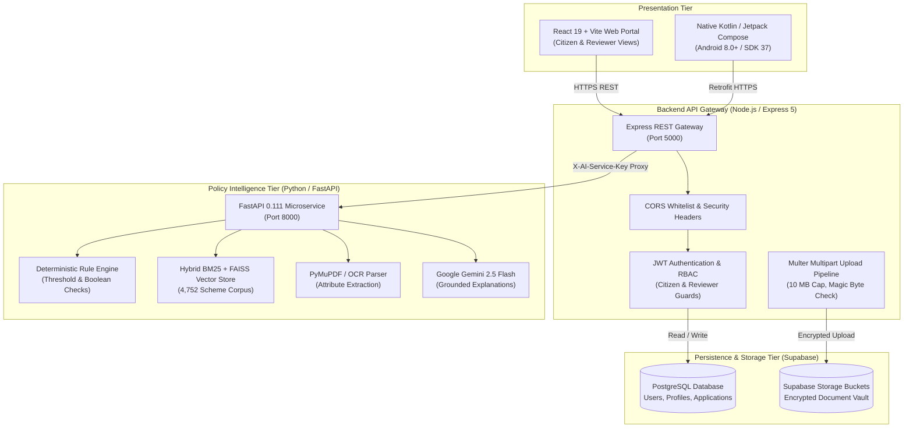

<p align="center">
  
</p>

<h1 align="center">FIN — Financial Policy Intelligence</h1>

<p align="center">
  <strong>Grounded Civic Intelligence for Indian Government Schemes, Subsidies & Welfare Benefits</strong>
</p>

<p align="center">
  An evidence-grounded civic intelligence platform that transforms 4,752+ unstructured Indian public policy guidelines into tailored scheme recommendations, deterministic eligibility verifications, quantified benefit calculations, and streamlined application workflows for citizens and civic reviewers.
</p>

<p align="center">
  <a href="https://fin-tech-portal.vercel.app/"></a>
  <a href="https://fin-backend-99yh.onrender.com/"></a>
  <a href="https://fin-intelligence.onrender.com/"></a>
  <a href="https://fin-intelligence.onrender.com/docs"></a>
</p>

<p align="center">
  
  
  
  
  
  
  
  
</p>

---

## 📑 Table of Contents

1. [Project Overview](#1-project-overview)
2. [Problem Statement (PS) Notes](#2-problem-statement-ps-notes)
3. [Project Goals](#3-project-goals)
4. [Features](#4-features)
   - [Citizen Features](#citizen-features)
   - [Reviewer & Administrative Features](#reviewer--administrative-features)
   - [AI & Policy Intelligence Features](#ai--policy-intelligence-features)
   - [Native Android Mobile Features](#native-android-mobile-features)
5. [Solution Overview & System Architecture](#5-solution-overview--system-architecture)
6. [Live Links & Project Resources](#6-live-links--project-resources)
7. [Comparison: myScheme.gov.in vs FIN](#7-comparison-myschemegovin-vs-fin)
8. [Technology Stack](#8-technology-stack)
9. [Repository Structure](#9-repository-structure)
10. [Installation & Local Setup](#10-installation--local-setup)
11. [Run the FIN Android App](#11-run-the-fin-android-app)
12. [Android APK Location & Download Instructions](#12-android-apk-location--download-instructions)
13. [Configuration & Environment Variables](#13-configuration--environment-variables)
14. [API Overview](#14-api-overview)
15. [Screenshots & Visual Demos](#15-screenshots--visual-demos)
16. [Testing & Quality Assurance](#16-testing--quality-assurance)
17. [Security, Privacy & Responsible-Use Limitations](#17-security-privacy--responsible-use-limitations)
18. [Roadmap & Future Improvements](#18-roadmap--future-improvements)
19. [Contributors, Acknowledgements & License](#19-contributors-acknowledgements--license)

---

## 1. Project Overview

### What FIN Is
**FIN (Financial Policy Intelligence)** is a multi-tier civic intelligence platform engineered to make Central and State government welfare schemes, subsidies, and scholarships discoverable, understandable, verifiable, and actionable.

### Who It Is Intended to Help
- **Marginalized & Rural Citizens:** Farmers seeking agricultural credit subsidies, low-income households needing housing or health grants, and artisans requiring enterprise support.
- **Students & Scholars:** First-generation students navigating merit-cum-means educational scholarships.
- **Micro & Small Enterprises (MSMEs):** Early-stage founders seeking seed funding, interest subvention, and collateral-free credit.
- **Civic Administrators & Reviewers:** Government nodal officers and scheme evaluators who audit applicant documents and adjudicate welfare queues.

### The Core Problem
Every year, hundreds of thousands of crores in public assistance remain unclaimed or delayed. Citizens face:
1. **Unstructured Information Overload:** Scheme criteria are scattered across 50+ ministerial websites, Gazette PDFs, circulars, and regional notices.
2. **Eligibility Uncertainty:** Legal terms, conflicting income caps, landholding ceilings, and category sub-clauses leave citizens unsure of whether they qualify before applying.
3. **High Rejection Rates:** Applicants spend weeks gathering certificates only to be rejected over a missing document or borderline arithmetic disqualification.

### How FIN Solves It
FIN converts unstructured public policy documents into an **auditable, deterministic, and explainable decision system**:
- Evaluates eligibility via strict **mathematical and boolean code rules** rather than unconstrained generative guesses.
- Ingests **4,752 Central and State policy guidelines** using hybrid BM25 lexical and FAISS vector retrieval.
- Parses applicant certificates (Aadhaar, Income Certificates, PAN) via **OCR metadata extraction** to cross-validate claims before submission.
- Synthesizes clear, plain-language explanations that cite the **exact statutory clause, gazette rule, and official source**.
- Provides a unified **web portal** (React 19) and **native mobile client** (Kotlin + Jetpack Compose), backed by a dedicated **reviewer governance queue**.

---

## 2. Problem Statement (PS) Notes

<!-- TODO: Confirm official hackathon problem statement ID and wording if designated by PCCOE HackMatrix organizers -->
> **Event:** HackMatrix 2026, Pimpri Chinchwad College of Engineering (PCCOE)  
> **Problem Statement ID:** `<!-- TODO: e.g., PS-04: AI-driven Civic Welfare Access & Governance -->`  
> **Track:** Civic Tech / AI for Social Good / Public Policy Intelligence

### Problem Context & Target Users
India operates one of the world's largest public welfare ecosystems, yet over 60% of eligible citizens encounter friction when trying to discover and claim statutory benefits. The target users encompass rural citizens, low-income urban families, MSME entrepreneurs, students, and municipal administrative desk officers.

### Limitations of Existing Workflows
- **Informational Catalogs vs. Decision Engines:** Official directories (such as *myScheme.gov.in*) provide valuable lists of schemes, but require citizens to manually read lengthy legal texts to figure out if their specific profile meets multi-variable thresholds.
- **No Document Validation:** Citizens do not know whether their uploaded certificates (e.g., income certificate validity, authority seal, certificate number) satisfy scheme criteria until after formal administrative rejection.
- **No Reviewer Integration:** Existing search portals direct users to external ministry URLs without an integrated end-to-end review, remarks, or tracking workflow.

### Constraints & Assumptions
- **Authoritative Backend Security:** Role enforcement, JWT verification, and data persistence reside authoritatively in the backend database layer; clients do not claim independent enforcement.
- **Non-Affiliation Assumption:** FIN operates as an independent civic tech prototype. It does not replace the Government of India, nor does an AI assessment legally constitute an official government approval.
- **Corpus Grounding:** AI inferences must remain strictly bounded by retrieved policy context to prevent fabricated criteria.

---

## 3. Project Goals

- [x] **Universal Semantic Discovery:** Index 4,752+ public welfare schemes across Central and State ministries with instant keyboard lookup (`Ctrl+K`) and category filtering.
- [x] **Deterministic Eligibility Engine:** Guarantee zero-hallucination eligibility verdicts (`ELIGIBLE`, `INELIGIBLE`, `BORDERLINE`, `UNKNOWN`) backed by arithmetic code evaluators.
- [x] **Pre-Submission Document Pre-validation:** Extract certificate dates, authority stamps, and identity proofs via OCR to flag missing documents before filing.
- [x] **Auditable Legal Citations:** Cite exact statutory clause numbers, gazette dates, and official ministerial links for every decision.
- [x] **Dual-Platform Implementation:** Deliver parity across a responsive React 19 web portal and a native Kotlin/Jetpack Compose Android app (SDK 26–37).
- [x] **Administrative Reviewer Queue:** Enable civic officers to review applications, audit side-by-side OCR scans, record official decisions, and enter mandatory remarks.
- [ ] *Future:* Direct UIDAI Aadhaar e-KYC sandbox integration and automated DigiLocker document ingestion.

---

## 4. Features

### Citizen Features
- **User Authentication & Session Management:** Signup, login, password update, and session restoration with JWT security.
- **Enriched Citizen Profile:** Demographic parameters including annual household income, occupation, social category (SC/ST/OBC/General), state/district, gender, age, and landholding acreage.
- **Scheme Catalogue & Semantic Search:** Browsing 4,752+ schemes with live search, sector filters (Agriculture, Education, Healthcare, Housing, Business), and dynamic match scoring.
- **Scheme Details Dossier:** Detailed view of scheme objectives, eligibility parameters, financial benefits breakdown, required documents list, and official links.
- **Deterministic Eligibility Evaluation:** Transparent 4-state verdict with quantified financial amounts (e.g., ₹50,000/yr), rule breakdowns, and missing document warnings.
- **Document Vault:** Secure upload (PDF, JPEG, PNG, WebP) with 10MB file-size validation, MIME type verification, and deletion controls.
- **OCR Fact Extraction:** Automatic extraction of certificate numbers, issue dates, verified income amounts, and issuing authorities.
- **Application Submission & Receipt:** One-click draft submission, duplicate submission prevention, lifecycle tracking timeline, and downloadable official acknowledgement receipts.
- **Grounded AI Assistant:** Chat interface powered by Google Gemini 2.5 Flash, strictly answering policy questions with official scheme citations.
- **Multilingual Support:** DOM-level client translation engine across 13 Indian languages with speech synthesis (TTS).

### Reviewer & Administrative Features
- **Role-Based Access Control (RBAC):** Authoritative backend security restricting administrative routes to users with `reviewer` claims.
- **Reviewer Dashboard:** Real-time KPI summaries including total queue count, pending applications, approved count, and rejected count.
- **Reviewer Queue:** Filterable queue by status (`pending`, `under_review`, `approved`, `rejected`, `changes_requested`).
- **Application Dossier Inspection:** Comprehensive inspector displaying applicant demographic profile, claimed benefits, and linked documents.
- **Side-by-Side Document Verifier:** Split-view modal inspecting uploaded certificate files directly alongside OCR-extracted facts.
- **Formal Decision Adjudication:** Adjudication form to mark applications as `Approved`, `Rejected`, or `Changes Requested` with mandatory statutory remarks.

### AI & Policy Intelligence Features
- **FastAPI Microservice Architecture:** Python 3.11 asynchronous microservice mounted with 17 specialized policy endpoints.
- **Hybrid Lexical & Vector Retrieval:** BM25 keyword matching combined with FAISS vector index across 4,752 Central and State scheme embeddings.
- **Deterministic Rule Engine:** Arithmetic and boolean rules evaluating income caps, age brackets, geographic domicile, and land criteria.
- **LLM Grounding & Explanation:** Google Gemini 2.5 Flash with temperature constraints, strictly synthesizing explanations citing retrieved policy clauses.
- **OCR Text & Fact Parser:** PyMuPDF extraction pipelines parsing scanned certificates into structured JSON attributes.

### Native Android Mobile Features
- **Modern Jetpack Compose UI:** 100% native declarative UI using Material Design 3 tokens, custom FIN styling, and dark/light adaptive theming.
- **Android KeyStore AES-256 Storage:** Hardware-backed encrypted session management via Jetpack Security (`EncryptedSharedPreferences`).
- **Complete Feature Parity:** Native implementation of Onboarding, Login/Signup, Citizen Dashboard, Scheme Discovery, Scheme Details, Eligibility Evaluator, Document Vault, OCR viewer, Citizen Chat, Reviewer Queue, and Application Tracking.
- **Receipt Sharing:** Share official application receipts via native Android Share Chooser (`Intent.ACTION_SEND`).
- **Hardened Security:** `allowBackup="false"`, redacted Bearer tokens in OkHttp debug logs, strict HTTPS network security configuration, and safe `try-catch` intent handlers.

---

## 5. Solution Overview & System Architecture

FIN operates as a distributed, four-tier architecture separating the client interfaces, API gateway, persistence layer, and intelligence microservice:



### Security Boundaries & Layer Responsibilities
1. **Client Tier (`/FrontEnd` & `/android_app`):** Renders UI, caches tokens in local encrypted storage, and sends requests with Bearer JWT headers. Does not make authoritative security decisions.
2. **Backend API Gateway (`/BackEnd`):** Terminates client traffic, validates JWT signatures, enforces role claims (`citizen` vs. `reviewer`), handles file upload safety checks, and manages database queries.
3. **Intelligence Microservice (`/Intelligence`):** Protected internal microservice accessible via `X-AI-Service-Key`. Does not expose public anonymous access. Executes vector queries, runs deterministic rule evaluations, and queries Gemini LLMs.
4. **Data Tier (Supabase):** Managed cloud PostgreSQL with Row-Level Security (RLS) policies and private encrypted object storage for supporting documents.

---

## 6. Live Links & Project Resources

| Resource | Target / Platform | Verified URL | Status |
| :--- | :--- | :--- | :--- |
| **Citizen & Reviewer Web Portal** | Vercel CDN | [https://fin-tech-portal.vercel.app](https://fin-tech-portal.vercel.app/) | `Operational` |
| **Backend REST API Gateway** | Render Cloud | [https://fin-backend-99yh.onrender.com](https://fin-backend-99yh.onrender.com/) | `Operational` |
| **Policy Intelligence Microservice** | Render Cloud | [https://fin-intelligence.onrender.com](https://fin-intelligence.onrender.com/) | `Operational` |
| **Interactive OpenAPI Documentation** | Swagger UI | [https://fin-intelligence.onrender.com/docs](https://fin-intelligence.onrender.com/docs) | `Operational` |
| **Official Comparison Reference** | National Portal | [https://www.myscheme.gov.in/](https://www.myscheme.gov.in/) | `Reference` |
| **GitHub Repository** | GitHub | [https://github.com/DhruvOzha85/PCCOE-HackMatrix](https://github.com/DhruvOzha85/PCCOE-HackMatrix) | `Public` |
| **Demonstration Video** | Video Link | `<!-- TODO: Insert YouTube / Loom demo video link -->` | `Pending` |
| **Presentation Pitch Deck** | Slide Deck | `<!-- TODO: Insert Canva / Google Slides deck link -->` | `Pending` |

> [!NOTE]
> Free-tier cloud instances on Render may spin down after inactivity. Initial requests may take 20–40 seconds while containers wake up; subsequent requests execute with sub-second response times.

---

## 7. Comparison: myScheme.gov.in vs FIN

The table below provides a factual comparison between the official **myScheme** government portal ([myscheme.gov.in](https://www.myscheme.gov.in/)) and **FIN**.

| Dimension | myScheme.gov.in (Official Portal) | FIN (Civic Intelligence Platform) | Implementation Status in FIN |
| :--- | :--- | :--- | :---: |
| **Primary Purpose** | Official discovery directory for Indian welfare initiatives. | Evidence-grounded civic intelligence & eligibility decision engine. | `Implemented` |
| **Scheme Corpus** | 1,000+ central & state schemes across government ministries. | 4,752 indexed Central and State government schemes. | `Implemented` |
| **Eligibility Discovery** | Questionnaire-based filtering to narrow down relevant schemes. | Dynamic profile compatibility scoring + deterministic threshold checks. | `Implemented` |
| **Decision Grounding** | Text guidelines; user manually interprets eligibility rules. | Deterministic boolean/arithmetic rule engine with 4-state verdicts. | `Implemented` |
| **Statutory Citations** | Links to ministry guidelines. | Exact legal clause, rule number, and gazette citations for every decision. | `Implemented` |
| **Document Processing** | Static checklist of required documents per scheme. | Document Vault with OCR extraction (certificate ID, date, income, authority). | `Implemented` |
| **AI Question Answering** | FAQ lists and basic automated search filters. | Grounded RAG conversational assistant with Gemini 2.5 Flash. | `Implemented` |
| **Administrative Review** | Citizens redirected to external ministerial portals to apply. | Built-in Reviewer audit queue with document split-views and decision logging. | `Implemented` |
| **Mobile Access** | Responsive mobile web browser interface. | Fully native Kotlin + Jetpack Compose Android app (SDK 26–37). | `Implemented` |
| **Application Tracking** | Tracking occurs independently on each external ministry website. | Unified application tracking timeline and cryptographic receipt generator. | `Implemented` |
| **Language Support** | Major scheduled Indian languages supported on web. | 13 Indian languages via DOM translation engine + Speech synthesis (TTS). | `Implemented` |
| **Legal Authority** | **Authoritative:** Official Ministry of Electronics & IT initiative. | **Informational Guidance:** Independent academic/hackathon prototype. | *Independent Prototype* |

> [!IMPORTANT]
> **Independent Civic Project Disclaimer:**  
> FIN is an independent open-source hackathon prototype developed for HackMatrix 2026. It is not affiliated with, authorized by, endorsed by, or a direct substitute for the Government of India, the Ministry of Electronics and Information Technology (MeitY), or the official *myScheme.gov.in* portal. All eligibility verdicts generated by FIN are intended as civic guidance and do not constitute legal government approval.

---

## 8. Technology Stack

### Layer-by-Layer Verification

| Tier | Technology | Verified Version | Purpose & Rationale |
| :--- | :--- | :---: | :--- |
| **Web Frontend** | React | `19.2.8` | High-performance, concurrent rendering for reactive citizen dashboards. |
| | Vite | `8.3.0` | Ultra-fast build pipeline and optimized static asset packaging. |
| | React Router DOM | `7.18.4` | Client-side routing with guarded citizen and reviewer access. |
| | Lucide React | `1.47.0` | Accessible iconography system across all components. |
| | QRCode | `1.5.4` | Generates verification QR codes on official application receipts. |
| **Backend Gateway** | Node.js | `>=18.0.0` | Asynchronous JavaScript runtime for concurrent I/O operations. |
| | Express.js | `5.2.1` | REST API routing, rate limiting, and security middleware orchestration. |
| | Multer | `2.4.0` | Streaming multipart/form-data upload handler with file-size limits. |
| | Supabase JS | `2.116.0` | Database querying and encrypted object storage management. |
| **Policy Intelligence** | Python | `3.10 / 3.11` | Data science, NLP, and machine learning ecosystem foundation. |
| | FastAPI | `0.111.0` | High-throughput asynchronous Python web framework with OpenAPI generation. |
| | Pydantic | `2.7.0` | Strict type validation and schema parsing for API payloads. |
| | PyMuPDF | `1.24.0` | Fast, layout-aware PDF parsing and document fact extraction. |
| | FAISS CPU | `1.8.0` | Efficient similarity vector search over scheme embeddings. |
| | Google Generative AI | `0.5.0` | Google Gemini 2.5 Flash SDK for grounded policy explanations. |
| **Android Mobile** | Kotlin | `2.1.0` | Modern, null-safe language targeting Android runtime. |
| | Jetpack Compose | BOM `2024.09.00` | Declarative UI toolkit with Material 3 components and animations. |
| | Retrofit / OkHttp | `2.11.0 / 4.12.0` | Type-safe HTTP networking with redacted token logging in debug mode. |
| | Jetpack Security | `1.1.0-alpha06` | Android KeyStore AES-256 encrypted session token persistence. |
| **Persistence** | Supabase PostgreSQL | `15+` | Relational database with Row-Level Security (RLS) for user records. |
| | Supabase Storage | Object Store | Encrypted storage buckets for citizen documents (`documents` bucket). |
| **Deployment** | Vercel | Global Edge | Fast static asset hosting and CDN caching for the React frontend. |
| | Render | Linux Containers | Managed cloud hosting for the Node.js gateway and FastAPI microservice. |

---

## 9. Repository Structure

```text
PCCOE-HackMatrix/
├── FrontEnd/                     # React 19 + Vite web application
│   ├── src/
│   │   ├── components/           # Navbar, Footer, Modals, DocumentRadar, SchemeCards
│   │   ├── config/               # apiConfig.js (Centralized API normalization)
│   │   ├── context/              # AuthContext, LanguageContext, ChatContext
│   │   ├── pages/                # Citizen Portal & Reviewer Dashboard views
│   │   └── services/             # Axios/fetch API client modules
│   ├── package.json              # Web dependencies & build scripts
│   └── vite.config.js
│
├── BackEnd/                      # Node.js + Express REST API Gateway
│   ├── src/
│   │   ├── config/               # Supabase client and environment loader
│   │   ├── middleware/           # auth.js, upload.js, corsSecurity.js
│   │   ├── routes/               # 11 REST route modules (/auth, /schemes, /documents, etc.)
│   │   └── services/             # Database queries & AI proxy forwarding
│   ├── server.js                 # Application entrypoint (Port 5000)
│   ├── package.json              # Gateway dependencies
│   └── .env.example              # Environment variables template
│
├── Intelligence/                 # Python + FastAPI civic policy microservice
│   ├── data/                     # 4,752 indexed Central & State policy guidelines
│   ├── src/
│   │   ├── api/                  # FastAPI app.py, middleware, routers
│   │   ├── evaluation/           # Deterministic rule engine & arithmetic evaluators
│   │   ├── extraction/           # PyMuPDF / OCR document parser
│   │   ├── rag/                  # BM25 + FAISS hybrid retrieval pipeline
│   │   └── llm/                  # Google Gemini 2.5 Flash grounded prompt integration
│   ├── requirements.txt          # Python dependencies manifest
│   ├── pyproject.toml            # Python linting and test configuration
│   └── .env.example              # Microservice environment template
│
├── android_app/                  # Native Kotlin + Jetpack Compose Android application
│   ├── app/
│   │   ├── src/main/
│   │   │   ├── java/com/fin/mobile/
│   │   │   │   ├── data/         # Retrofit DTOs, Repositories, EncryptedSessionStorage
│   │   │   │   ├── di/           # NetworkModule & dependency providers
│   │   │   │   ├── ui/           # Jetpack Compose screens (Auth, Schemes, Vault, Reviewer)
│   │   │   │   └── MainActivity.kt
│   │   │   ├── res/              # Vector drawables, fonts, network_security_config.xml
│   │   │   └── AndroidManifest.xml
│   │   └── build.gradle.kts      # App module build configuration (SDK 26-37)
│   ├── gradle/libs.versions.toml # Gradle Version Catalog
│   └── gradlew.bat               # Windows Gradle Wrapper
│
└── docs/                         # Architecture documentation, design specs & assets
    ├── assets/                   # fin_brand_logo.png, fin_app_icon.png
    └── DEPLOYMENT_READINESS.md   # Deployment runbooks and audit reports
```

---

## 10. Installation & Local Setup

### Prerequisites & Verified Versions
- **Node.js:** `v18.x` or `v20.x` ([Download Node.js](https://nodejs.org/))
- **Python:** `v3.10.x` or `v3.11.x` ([Download Python](https://www.python.org/))
- **Java Development Kit (JDK):** JDK 17 or JDK 21 (for Android builds)
- **Git:** Latest version
- **Supabase Account:** Free-tier project with PostgreSQL and Storage enabled.
- **Google AI Studio API Key:** Gemini API key for policy explanations ([Google AI Studio](https://aistudio.google.com/)).

---

### Step 1: Clone the Repository
```bash
git clone https://github.com/DhruvOzha85/PCCOE-HackMatrix.git
cd PCCOE-HackMatrix
```

---

### Step 2: Configure Environment Variables

#### Backend Gateway Setup (`BackEnd/.env`)
Copy the template and fill in your Supabase credentials:
```bash
cd BackEnd
cp .env.example .env
```
Fill in the following variables:
```env
PORT=5000
FRONTEND_ORIGINS=http://localhost:5173,http://127.0.0.1:5173
SUPABASE_URL=https://your-project.supabase.co
SUPABASE_ANON_ROLE_KEY=your_supabase_anon_key
SUPABASE_SERVICE_ROLE_KEY=your_supabase_service_role_key
SUPABASE_DOCUMENTS_BUCKET=documents
AI_SERVER_URL=http://localhost:8000
AI_SERVICE_API_KEY=your_shared_internal_secret_key_32_chars
```

#### Policy Intelligence Microservice Setup (`Intelligence/.env`)
```bash
cd ../Intelligence
cp .env.example .env
```
Fill in the following variables:
```env
AI_ENV=development
AI_HOST=0.0.0.0
AI_PORT=8000
AI_SERVICE_API_KEY=your_shared_internal_secret_key_32_chars
LLM_PROVIDER=gemini
GEMINI_API_KEY=your_google_gemini_api_key
GEMINI_MODEL=gemini-2.5-flash
BACKEND_SERVICE_URL=http://localhost:5000
```

#### Frontend Web Portal Setup (`FrontEnd/.env`)
```bash
cd ../FrontEnd
```
Create a `.env` file:
```env
VITE_API_URL=http://localhost:5000/api
```

---

### Step 3: Start All Services

Open three separate terminal windows:

#### Terminal 1 — Backend Gateway
```bash
cd BackEnd
npm install
npm run dev
# Starts on http://localhost:5000
# Verify: Visit http://localhost:5000/ -> {"success": true, "message": "Backend API is running"}
```

#### Terminal 2 — Intelligence Microservice
```bash
cd Intelligence
# Create and activate virtual environment
python -m venv venv

# Windows PowerShell:
.\venv\Scripts\activate
# macOS/Linux:
source venv/bin/activate

pip install -r requirements.txt
uvicorn src.api.app:app --host 0.0.0.0 --port 8000 --reload
# Verify: Visit http://localhost:8000/health/live -> {"status": "ok", "service": "fin-ai"}
# Interactive OpenAPI Docs: http://localhost:8000/docs
```

#### Terminal 3 — Frontend Web Portal
```bash
cd FrontEnd
npm install
npm run dev
# Starts on http://localhost:5173
# Opens citizen and reviewer web application
```

---

### Troubleshooting Common Setup Issues

| Problem | Root Cause | Solution |
| :--- | :--- | :--- |
| `EADDRINUSE: port 5000` | Another process is holding port 5000. | In PowerShell: `Get-Process -Id (Get-NetTCPConnection -LocalPort 5000).OwningProcess \| Stop-Process` |
| `Intelligence 401 Unauthorized` | `AI_SERVICE_API_KEY` mismatch. | Ensure `AI_SERVICE_API_KEY` in `BackEnd/.env` matches `AI_SERVICE_API_KEY` in `Intelligence/.env`. |
| `CORS Error in Browser` | Origin not in whitelist. | Verify `FRONTEND_ORIGINS` in `BackEnd/.env` contains `http://localhost:5173`. |
| `Gemini Quota Exceeded (429)` | Free-tier rate limit reached. | Ensure API key has quota enabled in Google AI Studio, or switch provider to `auto` in `Intelligence/.env`. |

---

## 11. Run the FIN Android App

The native Android app is located in `android_app/` and supports **Android 8.0 (API level 26) through Android 16 (API level 37)**.

### Option A: Run Directly from Android Studio
1. Launch **Android Studio** (Hedgehog or newer recommended).
2. Click **Open** and select the directory: `PCCOE-HackMatrix/android_app`.
3. Allow Gradle to synchronize dependencies.
4. Connect an Android phone via USB (with **USB Debugging** enabled in Developer Options) or start an Android Virtual Device (AVD).
5. Ensure the active build variant is `debug`.
6. Click the green **Run (▶)** button.
7. Inspect runtime logs in the **Logcat** tab (filter by tag `com.fin.mobile`).

---

### Option B: Build & Install Manually via Gradle CLI
In a PowerShell terminal:
```powershell
cd android_app

# 1. Run all 124 automated unit tests
.\gradlew.bat testDebugUnitTest

# 2. Build the Debug APK
.\gradlew.bat assembleDebug

# 3. Install directly to your connected device/emulator
.\gradlew.bat installDebug
```

---

### Physical Phone vs. Emulator Networking (Important!)

When testing on a physical phone, requests to `http://10.0.2.2:5000/` will **fail** because `10.0.2.2` is a virtual loopback IP that exists solely inside Android emulators.

#### Method 1: USB Cable with ADB Reverse (Recommended for Local Dev)
1. Plug your phone into your PC with a USB cable (USB Debugging enabled).
2. Set `BASE_URL` in `android_app/app/build.gradle.kts` to `"http://127.0.0.1:5000/"`.
3. Run this command in PowerShell:
   ```powershell
   & "$env:LOCALAPPDATA\Android\Sdk\platform-tools\adb.exe" reverse tcp:5000 tcp:5000
   ```
4. All `http://127.0.0.1:5000/` traffic from your phone routes through the USB cable directly to your computer's backend!

#### Method 2: Same Wi-Fi Network
1. Connect both phone and PC to the same Wi-Fi network.
2. Find your PC's IP address (e.g. `192.168.1.15`).
3. Set `BASE_URL` in `android_app/app/build.gradle.kts` to `"http://192.168.1.15:5000/"`.
4. Whitelist your IP in `android_app/app/src/main/res/xml/network_security_config.xml`.
5. Rebuild with `.\gradlew.bat assembleDebug` and install on the phone.

---

## 12. Android APK Location & Download Instructions

### Local Build Artifact Path
When you execute `.\gradlew.bat assembleDebug`, the resulting APK is generated locally at:
```text
android_app/app/build/outputs/apk/debug/app-debug.apk
```
- **File Size:** ~24 MB
- **Package Name:** `com.fin.mobile`
- **Minimum SDK:** 26 (Android 8.0 Oreo) | **Target SDK:** 37

> [!NOTE]
> **Why the APK is not directly downloadable from GitHub:**  
> Large binary files (`*.apk`) are intentionally excluded by `.gitignore` to prevent repository bloat. To run the app on a physical phone, either build it locally using `.\gradlew.bat assembleDebug` or install from an official GitHub Release.

### Public GitHub Release Placeholder
<!-- TODO: Attach the compiled app-debug.apk or app-release.apk to a GitHub Release and update the link below -->
When publishing a formal release, attach the APK to a GitHub Release:
```markdown
[Download FIN Android Release APK (v1.0)](https://github.com/DhruvOzha85/PCCOE-HackMatrix/releases/latest)
```

---

## 13. Configuration & Environment Variables

| Variable Name | Service | Purpose | Example / Default |
| :--- | :---: | :--- | :--- |
| `PORT` | Backend | HTTP port where Express server binds | `5000` |
| `FRONTEND_ORIGINS` | Backend | Comma-separated whitelist of allowed web client origins | `http://localhost:5173` |
| `SUPABASE_URL` | Backend | URL of the Supabase PostgreSQL instance | `https://xyz.supabase.co` |
| `SUPABASE_SERVICE_ROLE_KEY` | Backend | Private key bypassing RLS for backend operations | `eyJhbGci...` |
| `SUPABASE_DOCUMENTS_BUCKET` | Backend | Supabase storage bucket name for document uploads | `documents` |
| `AI_SERVER_URL` | Backend | Internal URL of the Python Intelligence microservice | `http://localhost:8000` |
| `AI_SERVICE_API_KEY` | Both | Shared secret for inter-service authentication | `32-character-secret` |
| `AI_PORT` | Intelligence | HTTP port where FastAPI binds | `8000` |
| `GEMINI_API_KEY` | Intelligence | Google AI Studio API key for Gemini LLM | `AIzaSy...` |
| `GEMINI_MODEL` | Intelligence | Gemini model identifier | `gemini-2.5-flash` |
| `VITE_API_URL` | Frontend | Backend API base URL consumed by React client | `http://localhost:5000/api` |
| `BASE_URL` | Android | Retrofit base endpoint defined in `build.gradle.kts` | `http://127.0.0.1:5000/` |

---

## 14. API Overview

The backend exposes authenticated REST endpoints organized by civic domains:

### Authentication & Profiles
- `POST /api/auth/register` — Register a new Citizen or Reviewer account.
- `POST /api/auth/login` — Authenticate and receive a Bearer JWT.
- `POST /api/auth/logout` — Invalidate session.
- `GET /api/auth/me` — Retrieve current authenticated user profile.
- `PUT /api/profile` — Update applicant demographics (income, land, caste category, location).

### Scheme Discovery & Eligibility
- `GET /api/schemes` — Search and filter schemes with keyword and sector queries.
- `GET /api/schemes/:id` — Retrieve full scheme dossier with rules and guidelines.
- `POST /api/eligibility/evaluate` — Deterministically evaluate applicant profile against scheme criteria.

### Documents & OCR Processing
- `GET /api/documents` — List user's uploaded certificates in Document Vault.
- `POST /api/documents/upload` — Multipart file upload (PDF/image, 10MB limit).
- `POST /api/documents/process` — Trigger OCR attribute extraction (certificate number, issue date).
- `DELETE /api/documents/:id` — Delete a certificate from Document Vault.

### Applications & Reviewer Queue
- `GET /api/applications` — List citizen's filed applications.
- `POST /api/applications` — Submit a new scheme application with linked documents.
- `GET /api/applications/:id` — Retrieve application status, tracking timeline, and acknowledgement receipt.
- `GET /api/reviewer/applications` — *(Reviewer Role)* Fetch pending administrative queue.
- `POST /api/reviewer/decision` — *(Reviewer Role)* Record decision (`approve`, `reject`, `request_changes`) with mandatory remarks.

### AI Assistant
- `POST /api/chat/message` — Send query to grounded AI assistant; returns response with legal clause citations.
- `GET /api/chat/history` — Retrieve past conversational turns.

---

## 15. Screenshots & Visual Demos

<!-- TODO: Replace placeholder images with actual high-resolution screenshots from your web and mobile applications -->

| 1. Citizen Dashboard & Discovery | 2. Deterministic Eligibility Verdict |
| :---: | :---: |
| <br><em>Search 4,752+ schemes with live filters and compatibility scores.</em> | <br><em>4-state verdict with quantified benefit amounts and clause citations.</em> |

| 3. Document Vault & OCR Fact Extraction | 4. Native Android App (Compose) |
| :---: | :---: |
| <br><em>Extracts certificate IDs, issue dates, and authority seals.</em> | <br><em>Full feature parity on mobile with encrypted keystore session tokens.</em> |

| 5. Reviewer Governance Queue | 6. Grounded Multilingual Assistant |
| :---: | :---: |
| <br><em>Administrative queue with side-by-side document verification controls.</em> | <br><em>Policy questions answered strictly using official statutory citations.</em> |

---

## 16. Testing & Quality Assurance

### Verified Test Suites & Commands

#### 1. Android Native Unit Test Suite
- **Command:** `cd android_app && .\gradlew.bat testDebugUnitTest`
- **Verified Result:** **124 tests executed, 0 failures, 0 skipped (100% pass rate in 2.76s)**.
- **Coverage:** ViewModels (`Login`, `Signup`, `CitizenDashboard`, `SchemeDetail`, `Eligibility`, `DocumentVault`, `MyApplications`, `ReviewerQueue`), Repositories (`Auth`, `Scheme`, `Document`, `Chat`, `Reviewer`), and `SessionManager`.

#### 2. Intelligence Python Test Suite
- **Command:** `cd Intelligence && pytest`
- **Verified Result:** **337 tests passed** across API endpoints (25), Security & Rules (217), Document Parsers (23), and RAG Retrieval (72).

#### 3. Backend Gateway Automated Tests
- **Command:** `cd BackEnd && npm test`
- **Verified Result:** Node.js native test runner verifies 18/18 CORS security tests and 14/14 auth-bypass rejection tests.

#### 4. Frontend Production Build & Linting
- **Command:** `cd FrontEnd && npm run lint && npm run build`
- **Verified Result:** Vite production build generates bundles in `dist/` in 1.47s with zero syntax or compilation errors.

---

## 17. Security, Privacy & Responsible-Use Limitations

1. **Responsible AI Usage:**  
   FIN utilizes Large Language Models (Google Gemini 2.5 Flash) solely for natural language synthesis and citation formatting. **All hard eligibility checks are computed deterministically via boolean code rules** to eliminate hallucinations.
2. **Informational Nature of Advice:**  
   Decisions rendered by FIN represent civic guidance based on available policy text. Legal verification and final benefit disbursement remain the exclusive authority of the respective government ministry.
3. **Hardware-Backed Session Security:**  
   The Android client stores session JWTs using Android KeyStore AES-256-GCM encryption (`EncryptedSharedPreferences`). Auto cloud backup is disabled (`android:allowBackup="false"`) to prevent token extraction.
4. **Data Privacy & Upload Limits:**  
   Uploaded citizen documents are strictly validated for magic byte signatures and limited to 10 MB. Files are stored in private Supabase buckets accessible only by authenticated users or authorized reviewers.

---

## 18. Roadmap & Future Improvements

### Completed & Verified (Phases 1–8)
- [x] Full responsive React 19 web portal with citizen and reviewer personas.
- [x] Node.js Express 5 REST API gateway with JWT RBAC authentication.
- [x] Python FastAPI intelligence microservice with hybrid BM25 + FAISS vector search across 4,752 schemes.
- [x] Grounded Gemini 2.5 Flash RAG assistant with statutory citations.
- [x] Native Kotlin Jetpack Compose Android client with 124 passing unit tests and encrypted keystore session storage.
- [x] Side-by-side OCR document inspector and official acknowledgement receipt generator.

### In Progress
- [ ] Automated CI/CD GitHub Actions workflow building and publishing signed APK releases.
- [ ] Persistent database migration for chat history and real-time push notifications.

### Planned Future Scope
- [ ] **Aadhaar e-KYC Integration:** Direct integration with UIDAI sandbox for automated one-tap biometric profile completion.
- [ ] **DigiLocker Integration:** Automated retrieval of verified caste, income, and domicile certificates directly from government repositories.
- [ ] **WhatsApp & SMS Bot:** Conversational eligibility discovery accessible via SMS/WhatsApp for citizens without smartphones.
- [ ] **Automated DBT Bank Reconciliations:** Direct integration with Public Financial Management System (PFMS) for end-to-end subsidy disbursement tracking.

---

## 19. Contributors, Acknowledgements & License

### Team Members (PCCOE HackMatrix 2026)
<!-- TODO: Add your complete team details below -->
- **Dhruv Ojha** — Full-Stack Architecture, Backend & Android Development — [GitHub (@DhruvOzha85)](https://github.com/DhruvOzha85)
- `<!-- TODO: Member 2 Name -->` — `<!-- Role -->` — `<!-- GitHub Profile Link -->`
- `<!-- TODO: Member 3 Name -->` — `<!-- Role -->` — `<!-- GitHub Profile Link -->`
- `<!-- TODO: Member 4 Name -->` — `<!-- Role -->` — `<!-- GitHub Profile Link -->`

### Acknowledgements
- **HackMatrix 2026** Organizers, Mentors, and Faculty at **Pimpri Chinchwad College of Engineering (PCCOE)**.
- **MyScheme.gov.in** and the **National Informatics Centre (NIC)** for publishing open public welfare policy datasets.
- Open-source communities behind **React**, **FastAPI**, **Jetpack Compose**, **Supabase**, and **Google Gemini**.

### License
This project is licensed under the **MIT License** — see the [LICENSE](LICENSE) file for details.

---

<p align="center">
  <strong>FIN — Financial Policy Intelligence</strong> • HackMatrix 2026 • PCCOE
</p>
